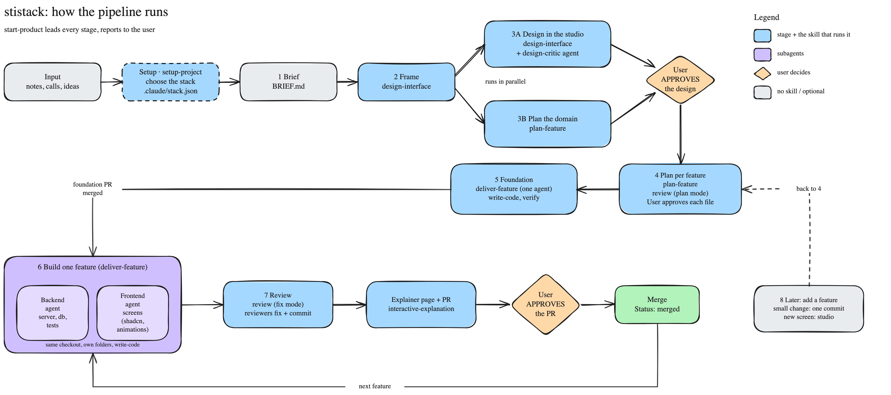

# stistack

A Claude Code plugin that takes a product from a brief to a proven app: a studio where a model designs every screen in React + shadcn while the domain is planned with you, your approval, one feature file per feature you approve in full, then one feature at a time built by a backend and a frontend agent in one checkout, each landing as a PR with an explainer page and videos you approve.

The look never drifts: the code you approve in the studio is the front end, and every later screen is built from its parts and tokens.

Version 0.23.0.



## Contents

- [The pipeline](#the-pipeline)
- [Install](#install)
- [What's inside](#whats-inside)
- [The studio](#the-studio)
- [Building](#building)
- [Develop this repo](#develop-this-repo)

## The pipeline

```
0 Input      requirements, calls, notes, your words
  Setup      setup-project: CLAUDE.md, plugin on, CHOOSE THE STACK ──► .claude/stack.json + its checks
1 Brief      short grill ──► BRIEF.md (confirmed lines cite their source, unknowns listed)
2 Frame      roles · screens · real records (= the draft data model)        ══ the fork ══
3A Design    the studio: one model designs every screen in React + shadcn, 3 sizes, light and dark,
             checks + design critic ──► you tune, comment, APPROVE ──► DESIGN.md, tokens, parts
3B Plan      with you while 3A runs: entities, roles, server functions, what can go wrong (misuse list)
4 Features   after APPROVE: screens wired to server functions ──► features/*.md, one per feature,
             Backend · Frontend · Scenarios with exact outcomes · Tests ──► you approve every file in full
5 Foundation one agent: routes + views built from the design pack, the schema, auth, shared/, the check command,
             the verify skill ──► a PR with an explainer ──► you approve
6 Build      ONE feature: a backend agent and a frontend agent, same checkout, own folders,
             scenarios ──► failing tests ──► code ──► the check command ──► e2e ──► the verify skill drives it
7 PR         interactive-explanation: page + journey video + architecture video ──► you approve ──► merge
             (while the next feature is already being built)
8 Later      add a feature: new screen? studio or straight into the app ──► 4 ──► 6 ──► 7
```

What you are asked at each stage, and the fixed rules, are in `plugin/skills/start-product/SKILL.md`.

## Install

The repo is a Claude Code plugin marketplace. It is private, so Claude Code clones it with your own git login.

```
/plugin marketplace add Stiliyan26/stistack
/plugin install stistack@stistack
```

Skills are then named `stistack:<skill>`, for example `/stistack:start-product`. The `design-critic` agent comes with the plugin.

**For a team.** Run the `setup-project` skill in the project. It copies `CLAUDE.md` (the working rules and the project's facts) and adds a `.claude/settings.json` that enables the plugin for everyone who trusts the folder. It never overwrites a file that exists.

**Choose the stack.** This happens once, at Setup, before the brief. `setup-project` copies `.claude/stack.json` with the default stack (`node-tanstack`); change it there if the project uses other tools, then the skill installs that stack's checks (the check command). Every later skill reads the stack from this file: `plan-feature` keeps it unless a real need says otherwise, `write-code` opens `write-code/stacks/<name>/`.

## What's inside

| Skill or agent | What it does |
| --- | --- |
| `start-product` | The pipeline: a short brief, frame, studio design while the domain is planned with you, approval, one feature file per feature you approve in full, the foundation, then one feature at a time built by a backend and a frontend agent in one checkout, each landing as a PR with an explainer. Owns the coordination rules. Also adds one feature later to a product that has a design and a plan. |
| `design-interface` | The design process and its tool: two-pass research, the product facts, one React + shadcn design per model in the studio, the quality gate, your choice, and the design pack export (rendered HTML, CSS, PNGs) with a pixel check. Owns the studio engine, the app template and the scripts. |
| `plan-feature` | Plans the domain (entities, roles, server functions, what can go wrong) while the screens are designed, the screen wiring after approval, and one feature file per feature with exact scenarios and every test, one decision at a time, answers saved as given. Links `DESIGN.md` instead of deciding the look again. Owns the feature file format. |
| `deliver-feature` | The backend agent or the frontend agent of one feature, in one checkout: scenarios into failing tests first, contract first, own folders only, the check command after every edit, the journeys driven in a real browser, notes for the feature file in its report to the lead. |
| `interactive-explanation` | Shows a change as a local page with a narrated journey video and an architecture video, and writes the PR description from the same script. Every feature and the foundation land through it. Adapted from Peter's skill. |
| `design-animations` | Purposeful motion on the built screens: transitions, gestures, performance, reduced motion. |
| `write-code` | The code rules a person must judge, then the project's stack folder (`stacks/<name>/`, picked by `.claude/stack.json`): folders, language style, UI, server side, tests and the `check` command that runs the linters, formatter, types and dead-code scan. |
| `verify` | Only on `/verify`. Writes the project's own verify skill into `.claude/skills/verify-<app>/` (launch, doctor, drive, evidence, stop) when there is none, else audits it: one source reader per feature file, one live pass driving every feature, one set of proven corrections. |
| `build-with-shadcn` | shadcn/ui in React: composition, forms, styling, icons, base vs radix, the CLI. |
| `setup-project` | Copies the working rules into a project, enables the plugin for the team, sets the stack in `.claude/stack.json` (the one place the stack is chosen), and installs that stack's checks. |
| `reflect` | Only on `/reflect`. Three parallel reviewers (judgment, tooling, divergent) read the session transcripts, a synthesizer sorts findings into Accepted / Rejected / Backlog, and nothing is applied to a skill until you approve. Ask it a focus question such as why a build was slow. Adapted from pstack. |
| `improve-skill` | Audits, creates and improves skills against Anthropic's skill-writing rules (46 rules, file and line evidence), checks that each skill stands alone and names only its handoff, rewrites rules in Simplified Technical English; validator and reference-checker scripts for the mechanical rules; edits nothing until the user approves. |
| `reply-format` | Formats every reply: a bold result line, one of four templates (quick answer, task done, options, problem), quoted sources, a Before/After sketch and a "What changed" section when behaviour changed, an explainer video after a big change, and a footer with the skills used and the real check output. Ships its own sketch script. |
| `design-critic` agent | Read-only. Scores screenshots on originality (40), design quality (25), craft (20) and function (15). Under 70, or any score of 1, means "revise first". The agent that built a design may not grade it. |
| `review` | Reviews a PR, a branch, a commit range, the whole app, uncommitted work (after you commit it) or a plan. One reviewer per feature proves each problem by running code, fixes it in a commit, and re-proves it; the lead runs the gates and tests once, and `interactive-explanation` writes the PR page. Only hard-to-undo choices and what is still open come to you. A plan, or "report only", gets report mode: `reviews/<date>-<target>/` for you to tick. |

Anthropic's `frontend-design` skill ships inside `design-interface` as `references/choose-a-look.md`. You don't need to install it separately.

## The studio

- The engine lives once, in the `design-interface` skill: `assets/studio-engine/` (server, checks, export, the page). It knows nothing about any one product.
- A project gets `studio/` (facts and the files the page writes) and `studio/app/` (one Vite + React + Tailwind 4 + shadcn app, every shadcn part installed) from `python3 <skill>/scripts/init_studio.py <project-root> --name "<product>"`.
- Each model writes only `studio/app/src/variants/<id>/`: `variant.json` (its look and custom parts), `screens/<screen>.tsx`, `parts/`. `npm run build` there type-checks and writes the studio's pages, listing the shadcn parts the screens import.
- The studio shows every screen of every model at 1920, 1440 and 390, light and dark. Palettes, tuning and the dark switch recolor shadcn parts and custom parts live, with no rebuild.
- You compare, pin comments, tune colors and press **Approve**. Approval writes `DESIGN.md` (with the Components table), `design/fonts.css`, `design/tokens.css` and `design/shadcn.css`. Only that button counts.
- `export_pack.mjs --check` writes `design/screens/`: each approved screen as rendered HTML with its CSS and PNGs at 1440 and 390, light and dark, proven against the studio within 1%. The build reads it; `compare_screens.mjs` later proves the built app matches it.
- Views, shortcuts, palettes, checks and the file formats: `plugin/skills/design-interface/references/studio.md`.

Screens color only through shadcn's names (`bg-primary`, `text-muted-foreground`, `border-border`) or `var(--color-…)`, `var(--status-…)`, `var(--radius-…)`, and fonts through `font-sans` and `font-heading`. `check_tokens.py` fails on anything else.

## Building

- Coordination is files and git, so it works in every CLI: one feature file per feature (its Backend and Frontend owners, its scenarios, its tests), a `requests/` folder for what a feature needs added to the foundation, and the lead merging one PR at a time. No worktrees: the two agents of one feature share a checkout and own different folders. Details: `plugin/skills/start/references/coordination.md`.
- The runtime: Claude Code subagents, or `claude -p` per agent as the fallback. Agents talk to the lead only through their reports and `requests/`.
- The default stack (`stacks/node-tanstack`, chosen at Setup in `.claude/stack.json`): Node 24 + pnpm, Vite+, TanStack Start (file routes, server functions), React Query, Table and Form, shadcn + Tailwind, zod, drizzle on Postgres, Vitest and Playwright, oxlint, oxfmt, knip. `write-code` says where every file goes.
- Every agent leaves a trace of what it ran, so you follow the run without reading transcripts.

## Develop this repo

- `plugin/` is the plugin: `.claude-plugin/plugin.json`, `skills/`, `agents/`. Edit skills and agents here.
- `.claude-plugin/marketplace.json` makes the repo its own marketplace.
- After a change, bump `version` in `plugin/.claude-plugin/plugin.json`.
- `.claude/skills` and `.claude/agents` link into `plugin/`, so this repo uses its own kit while you work on it.
- `examples/partyfox/` is a studio with three hand-written HTML variants from before the app flow; it still opens and is the engine test's shape. Run `cd examples/partyfox && python3 studio/server.py --port 4173`.
- Checks are in `CLAUDE.md`. The main ones:

```
node plugin/skills/design-interface/scripts/test_studio.mjs   # the engine, ~1 min
node plugin/skills/design-interface/scripts/test_app.mjs      # the app flow end to end, ~5 min
claude plugin validate ./plugin --strict
claude plugin validate . --strict
```
